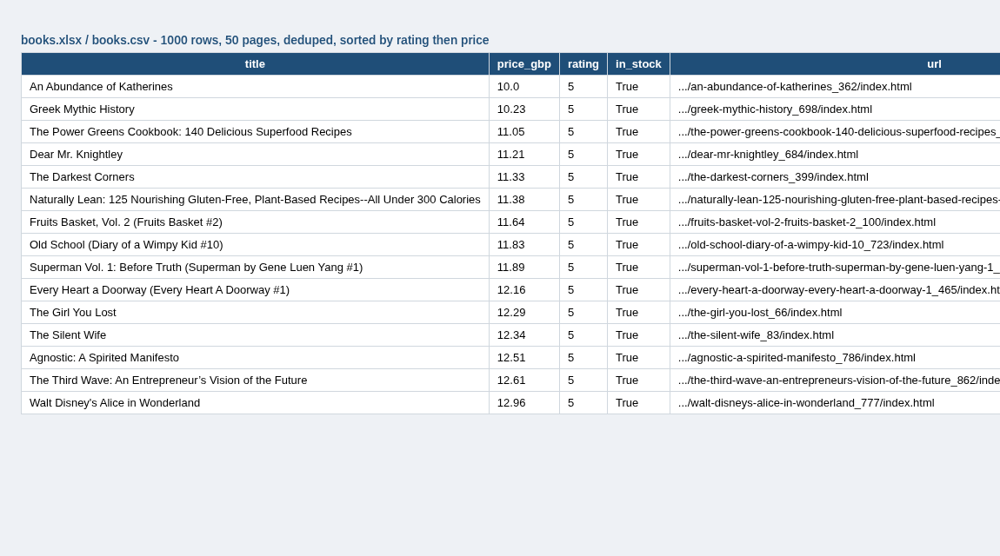

# Web Scraper -> Clean CSV / Excel

A sample project that scrapes all 1,000 books from [books.toscrape.com](https://books.toscrape.com), a sandbox site made for scraping practice, and exports a clean, sorted CSV and Excel file.



## Problem
A lot of small jobs come down to "get the data off these pages into a spreadsheet". The hard parts are usually following pagination, not falling over when a request fails, and not ending up with duplicates.

## Features
- Follows the "next" link through all 50 pages (or stop early with `--pages`).
- Retries with backoff on 429/5xx responses and connection errors, with a polite delay between pages.
- Parses title, price, star rating (as a number), stock status, and the full product URL.
- Dedupes by URL, sorts by rating then price.
- Exports CSV plus an Excel file with a styled header, frozen top row, and filters.
- Tests run offline against a fake session, so they don't hit the site.

## Usage
```bash
pip install -r requirements.txt
python scraper.py                 # all pages -> output/books.csv and output/books.xlsx
python scraper.py --pages 3 --out output/sample
pytest -q
```

## Sample output
```
page 50: 20 items
Pages: 50 | scraped: 1000 | after dedupe: 1000 -> output/books.csv / .xlsx
```

## Tech stack
Python 3, requests (urllib3 Retry), BeautifulSoup, openpyxl, pytest

Only scrape sites you are allowed to scrape. This demo targets a site built for practice.
